

  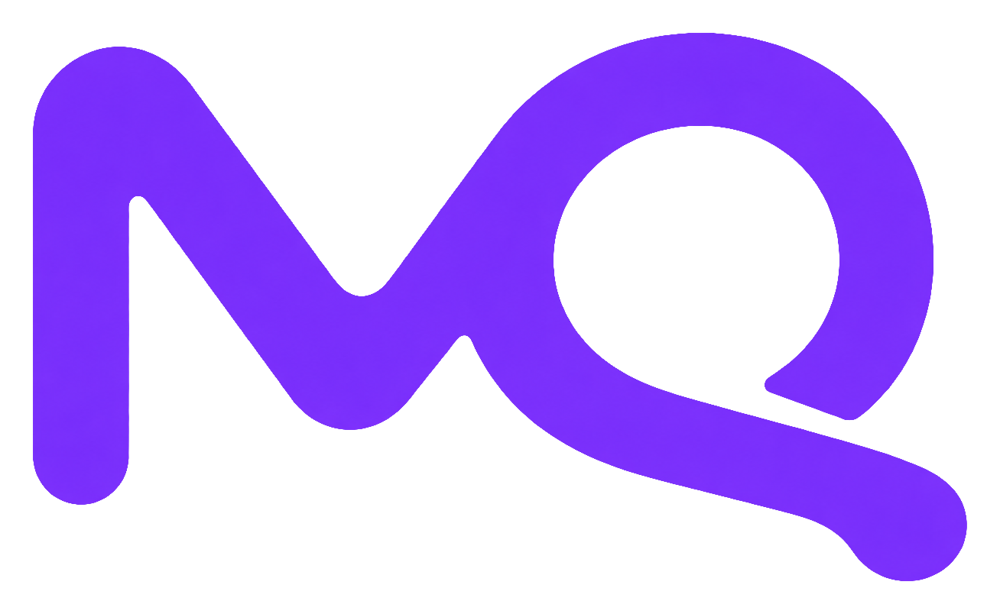
  <h2><i>Built with coffee, dice, and a few more lines of code than necessary.</i></h2>
  
<i>I turn “what if there was a tool for this?” into playful systems people actually use.</i>

  <a href="https://maiq.dev">portfolio</a> · <a href="#quest-log">quest log</a> · <a href="#skill-tree">skill tree</a>

> **CURRENT BUILD:** RPG tools, community bots, games, and web experiments, made with equal parts curiosity, structure, and chaos.

## ✦ Quest log

<table align="center" width="100%">
  <tr><td colspan="3" align="center">
    ✦ FEATURED QUEST · BROWSER GAMES  
    <a href="https://lorota.app">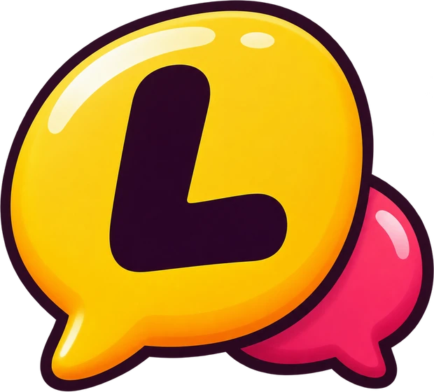 </a>
    
Forbidden words, mysteries and trivia. My Portuguese-language games, together in one place.

    <a href="https://lorota.app"><b>Explore Lorota ↗</b></a>  
  </td></tr>
  <tr>
    <td width="33.333%" valign="top" align="center"><a href="https://resenha.lorota.app"> <b>Resenha</b></a> Get someone to guess the word without saying the five forbidden ones.</td>
    <td width="33.333%" valign="top" align="center"><a href="https://enigmas.lorota.app"> <b>Enigmas</b></a> Uncover what happened with yes-or-no questions.</td>
    <td width="33.333%" valign="top" align="center"><a href="https://quiz.lorota.app"> <b>Quiz Arena</b></a> Choose a topic and see how many questions you get right.</td>
  </tr>
</table>

<table align="center" width="100%">
  <tr>
    <td width="33.333%" valign="top" align="center"><a href="https://gdi.maiq.dev">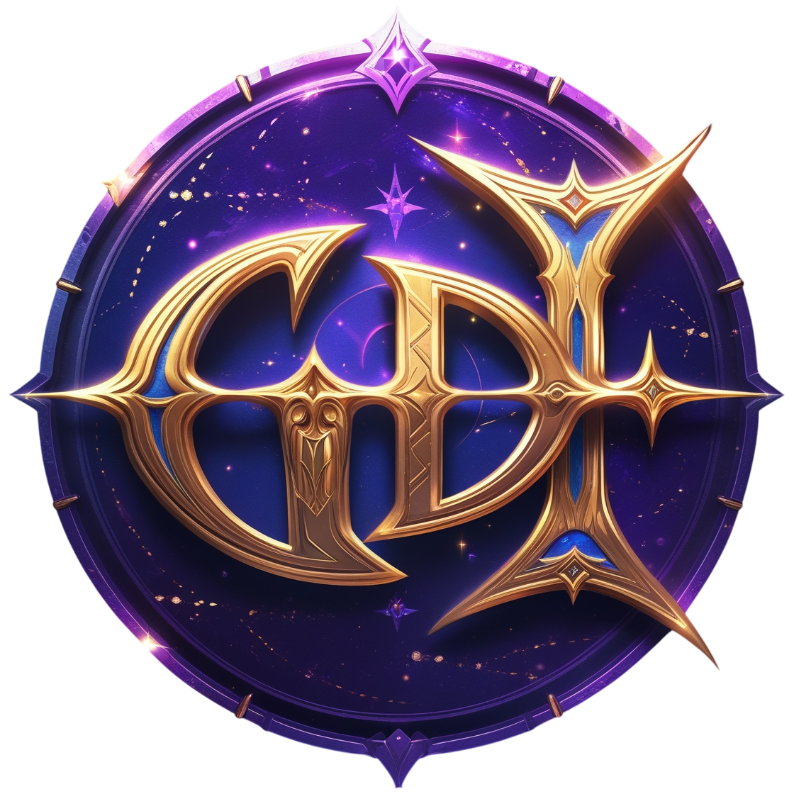 <b>GDI</b></a> RPG companion · Discord & Telegram</td>
    <td width="33.333%" valign="top" align="center"><a href="https://arcano.maiq.dev">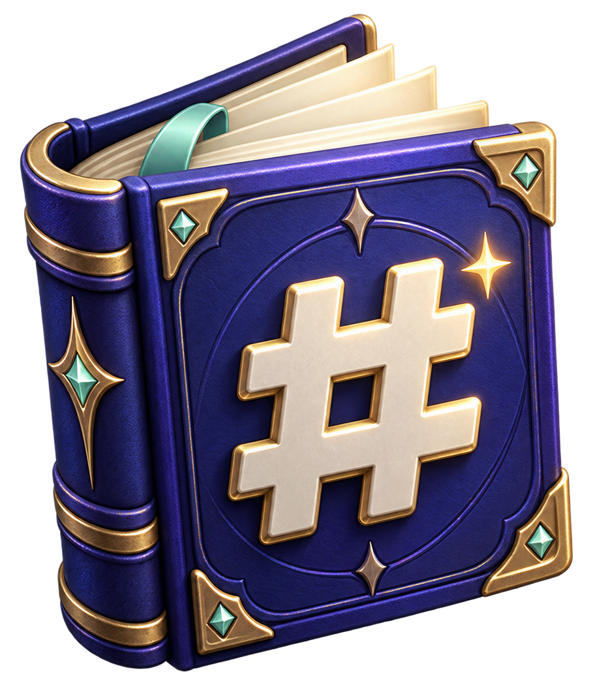 <b>Arcano</b></a> Browser toolkit · Discord communities</td>
    <td width="33.333%" valign="top" align="center"><a href="https://discord.gg/amongusbrasil">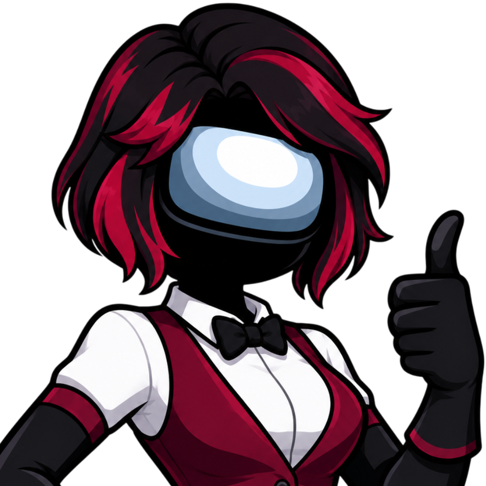 <b>Ruby</b></a> Discord operations · Among Us Brasil</td>
  </tr>
  <tr>
    <td width="50%" valign="top" align="center"><a href="https://github.com/maiqbr/Spellbook">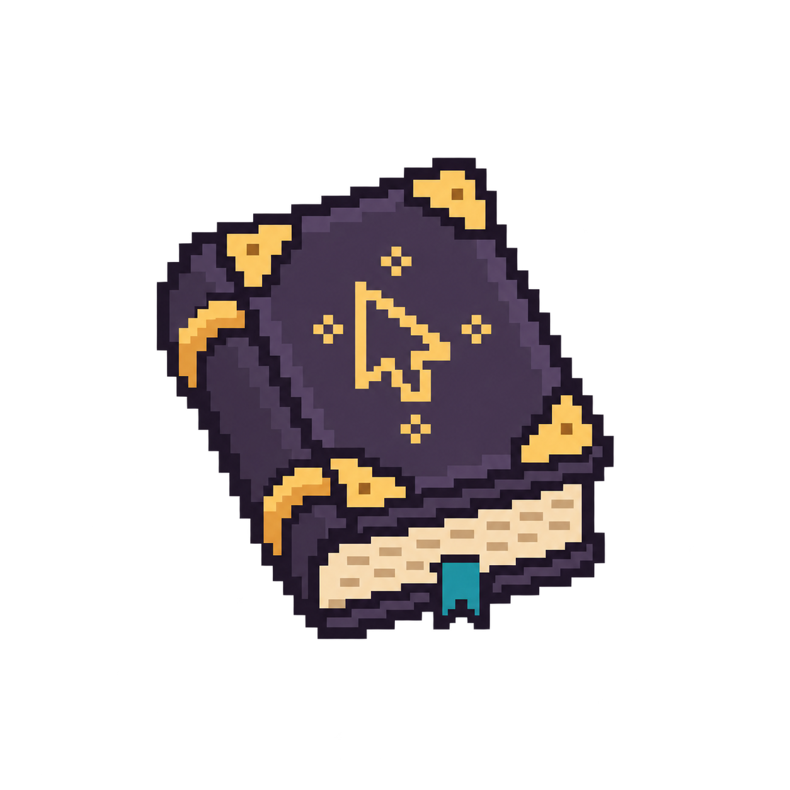 <b>Spellbook</b></a> Windows tray utility · Autoclicker &amp; keep active</td>
    <td width="50%" valign="top" align="center"><a href="https://github.com/maiqbr/grimorio-erp"> <b>Grimório</b></a> Personal workspace · Tasks, calendar & notes</td>
  </tr>
</table>

<a href="https://maiq.dev/#projetos">View all projects ↗</a>

## ✦ Skill tree

<table align="center" width="100%">
  <tr>
    <td width="25%" align="center">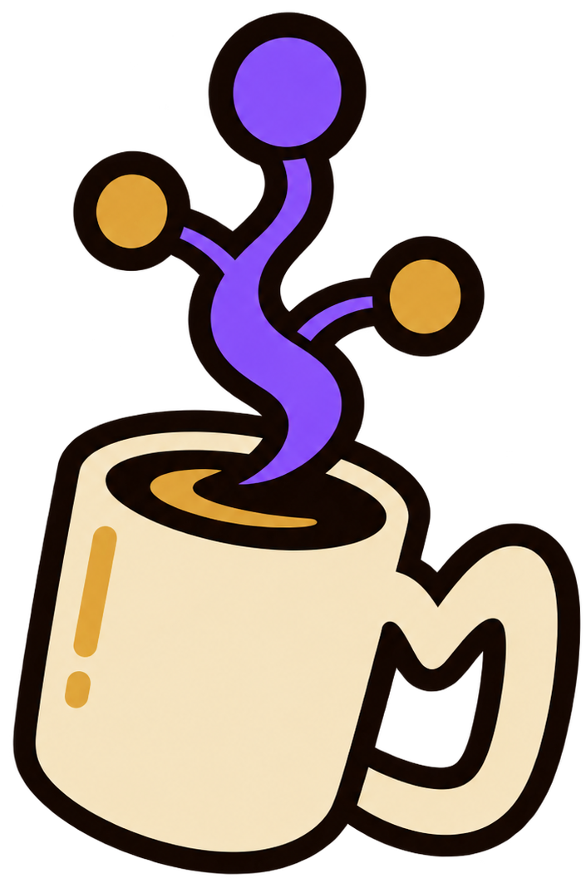</td>
    <td width="25%" align="center">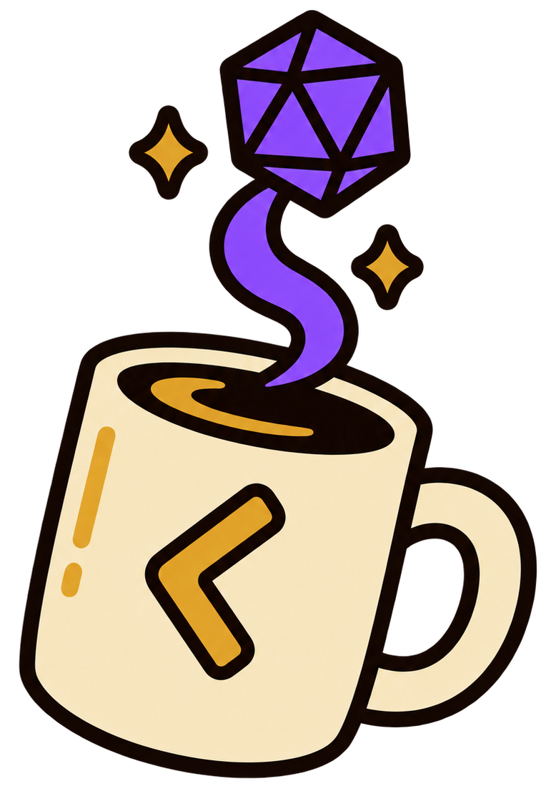</td>
    <td width="25%" align="center">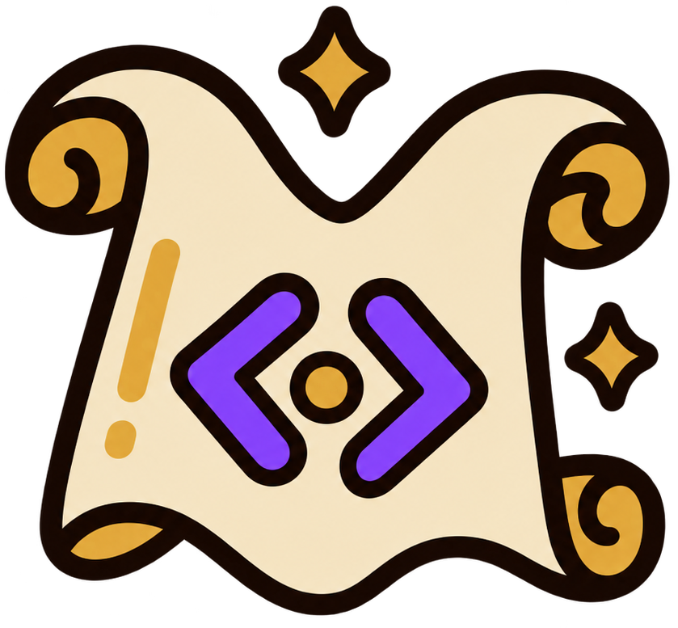</td>
    <td width="25%" align="center">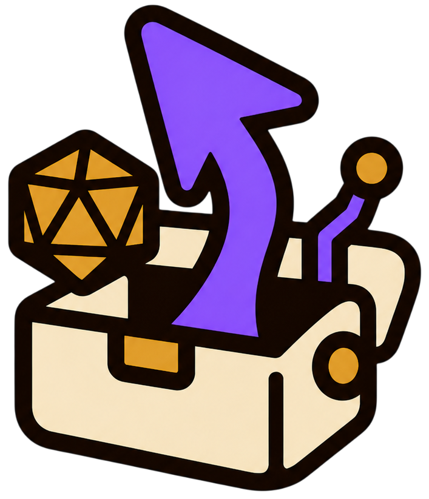</td>
  </tr>
  <tr>
    <td width="25%" align="center"><b>01 · SYSTEM DESIGN</b></td>
    <td width="25%" align="center"><b>02 · COMMUNITY TECH</b></td>
    <td width="25%" align="center"><b>03 · CODE CRAFT</b></td>
    <td width="25%" align="center"><b>04 · QUALITY OF LIFE</b></td>
  </tr>
  <tr>
    <td width="25%" align="center">RPG rules economies · game loops community flows</td>
    <td width="25%" align="center">Discord · Telegram moderation · events automation</td>
    <td width="25%" align="center">JavaScript · TypeScript C# · .NET · WebRTC web apps · UI/UX</td>
    <td width="25%" align="center">Accessibility · spoken dice shortcuts · useful details systems with personality</td>
  </tr>
</table>

<b>LOADOUT</b> &nbsp; JavaScript &nbsp;·&nbsp; TypeScript &nbsp;·&nbsp; C# / .NET &nbsp;·&nbsp; HTML/CSS &nbsp;·&nbsp; Discord &amp; Telegram APIs &nbsp;·&nbsp; WebRTC &nbsp;·&nbsp; Game Design

## 📜 Adventurer's record

  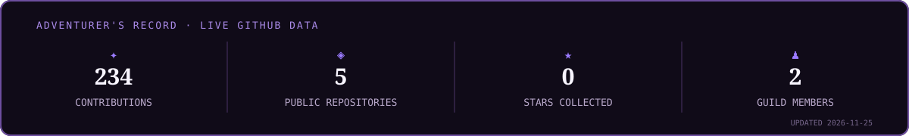

## 🗝️ Dungeon crawl

  

---

  <i>Built with coffee, dice, and a few more lines of code than necessary.</i>

